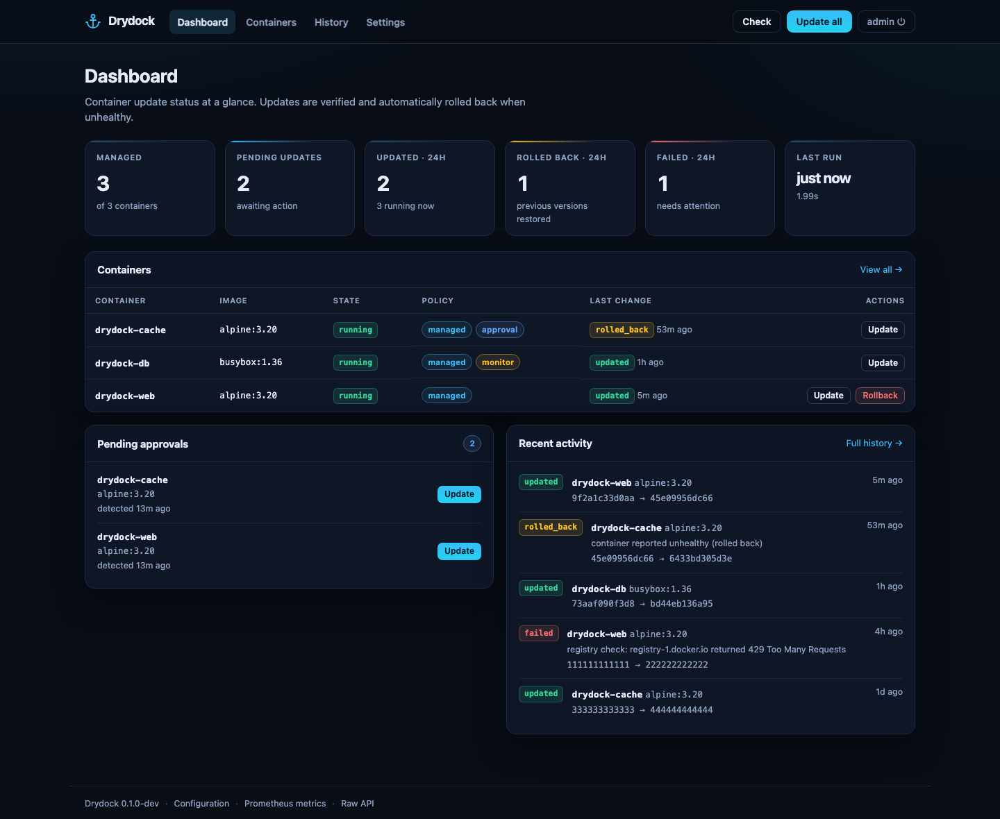

<div align="center">

# ⚓ Drydock

**Refit your containers. Safely.**

A Docker auto-updater that pulls new images, recreates containers from their
exact configuration, verifies the replacement is healthy, and **automatically
rolls back when it is not.**



<sub>The embedded dashboard: live status, per-container actions, and an audit trail.</sub>

</div>

---

Drydock is built around one rule: **a failed update should never leave your
service down.** If the new container crashes, fails its healthcheck, or does
not answer its health port, Drydock puts the previous container back and tells
you why.

```
┌──────────┐   pull    ┌───────────┐  verify  ┌────────────┐
│  check   │ ────────▶ │ recreate  │ ───────▶ │  healthy?  │
└──────────┘           └───────────┘          └─────┬──────┘
                            ▲                       │ no
                            │      ┌───────────┐    │
                            └──────│ rollback  │ ◀──┘
                                   └───────────┘
```

## Highlights

| Capability | What it gives you |
|---|---|
| Verified updates | Docker healthcheck, TCP/HTTP probe, crash-loop detection |
| Automatic rollback | Previous container restored when the new one fails |
| Manual rollback | `drydock rollback <container>` restores a previous image ID |
| Persistent history | Before/after image IDs and config snapshots in a JSON store |
| Flexible scheduling | Global interval or cron, plus per-container schedules |
| Dependency-aware | Links, `depends-on`, Compose `depends_on`, cycle detection |
| Registry-aware | Multi-arch digest matching, 429 backoff, TLS verification, private auth |
| Config as code | Strict YAML, labels, environment variables, and flags |
| Observability | Structured logs, Prometheus metrics, and a JSON API |
| Embedded dashboard | Live jobs, per-container actions, and an audit trail |
| Concurrency | Dependency levels updated in parallel, safely |

## Quick start

```bash
# Build the image (or use your own published tag)
docker build -t drydock .

docker run -d \
  --name drydock \
  --restart unless-stopped \
  --group-add 0 \
  -v /var/run/docker.sock:/var/run/docker.sock \
  -v drydock-data:/var/lib/drydock \
  -e DRYDOCK_INTERVAL=6h \
  drydock
```

> The image runs as the nonroot user, so it needs the group that owns the
> Docker socket. On Docker Desktop that is group `0`. On Linux use
> `--group-add "$(stat -c '%g' /var/run/docker.sock)"`. Running with
> `--user 0:0` also works but gives up the nonroot default.

Add a dashboard (see [Web dashboard](#web-dashboard)):

```bash
docker run -d --name drydock-ui \
  --group-add 0 \
  -p 127.0.0.1:8080:8080 \
  -e DRYDOCK_API_ENABLED=true \
  -e DRYDOCK_UI_PASSWORD='choose-a-strong-password' \
  -v /var/run/docker.sock:/var/run/docker.sock \
  -v drydock-data:/var/lib/drydock \
  drydock
```

Open <http://localhost:8080> and sign in as `admin` with the password you
chose (replace `choose-a-strong-password` above with a real secret).

For LAN access, replace `127.0.0.1` with `0.0.0.0`; if the port is reachable
from the internet, terminate TLS in a reverse proxy and keep the container on
`127.0.0.1`. Private images need registry credentials — see
[Private registries](#private-registries). For a server install, the
[Compose deployment](#deploy-on-a-server) is the recommended path.

That is enough: every six hours Drydock checks every running container,
updates the ones whose tag moved, and rolls back anything that fails to start.

Check what it would do first:

```bash
docker run --rm \
  --group-add 0 \
  -v /var/run/docker.sock:/var/run/docker.sock \
  -v drydock-data:/var/lib/drydock \
  drydock check --json
```

On Linux, replace `--group-add 0` with
`--group-add "$(stat -c '%g' /var/run/docker.sock)"`.

## Deploy on a server

The Compose file is production-shaped: nonroot user, read-only root filesystem,
all capabilities dropped, state on a named volume, log rotation, and the
dashboard bound to loopback by default.

### 1. Push the latest changes

```bash
cd drydock
git add .
git commit -m "Server-ready compose, env template, image publishing"
git push
```

`.env`, the binary, and state files are git-ignored.

### 2. Install on the server

Prerequisites: Docker Engine + Compose plugin, Git.

```bash
git clone git@github.com:sasho132/drydock.git
cd drydock

cp .env.example .env
# Linux: give the container the group that owns the socket
sed -i "s|^DOCKER_GID=.*|DOCKER_GID=$(stat -c '%g' /var/run/docker.sock)|" .env
$EDITOR .env                # set DRYDOCK_UI_PASSWORD
chmod 600 .env

# Optional: report what would change, without changing anything
docker compose run --rm drydock check

# Build and start. In build mode, `docker compose pull` is unnecessary and
# skips this service when DRYDOCK_IMAGE is not set.
docker compose up -d --build
docker compose logs -f drydock
```

The dashboard listens on `127.0.0.1:8080` by default. Reach it through an SSH
tunnel:

```bash
ssh -L 8080:127.0.0.1:8080 user@server
# open http://localhost:8080
```

For LAN access set `DRYDOCK_BIND=0.0.0.0` in `.env` (use a TLS reverse proxy if
it is reachable from the internet). Sign in as `admin` with
`DRYDOCK_UI_PASSWORD`; an empty password leaves the dashboard read-only.

### 3. Update Drydock itself

```bash
cd drydock
git pull
docker compose up -d --build
```

History and rollback snapshots live in the `drydock-data` volume and survive
rebuilds:

```bash
docker run --rm -v drydock-data:/data -v "$PWD":/backup busybox \
  tar czf /backup/drydock-state.tgz -C /data .
```

### Using a prebuilt image

`.github/workflows/publish.yml` publishes multi-arch images
(`linux/amd64`, `linux/arm64`) to GHCR for every `v*` tag:

```bash
git tag v0.2.0 && git push --tags
```

Make the GitHub package public, or run `docker login ghcr.io` on the server,
then switch the image in `.env` instead of building on the server:

```bash
# .env
DRYDOCK_IMAGE=ghcr.io/sasho132/drydock:latest

docker compose pull
docker compose up -d
```

Or build and push from your machine with `docker buildx`:

```bash
docker buildx build --platform linux/amd64,linux/arm64 \
  -t ghcr.io/sasho132/drydock:latest --push .
```

### Troubleshooting

| Symptom | Cause |
|---|---|
| `permission denied ... docker.sock` | `DOCKER_GID` does not match the socket's group |
| Dashboard says “read-only” | `DRYDOCK_UI_PASSWORD` is empty |
| `address already in use` | Change `DRYDOCK_PORT` in `.env` |
| `manifest unknown` on `docker compose pull` | You are pulling without a published image. Use `up -d --build`, or publish a `v*` tag, set `DRYDOCK_IMAGE`, and log in to GHCR / make the package public |
| The `drydock` row shows `rejected credentials` | An older build tried to update itself. Update Drydock; the Compose service now carries `drydock.enable: "false"` and self-detection is automatic |
| `denied access ... may be private` for your own image | Drydock has no registry credentials. See [Private registries](#private-registries) |
| Dashboard unreachable from another machine | It is bound to `127.0.0.1`. Set `DRYDOCK_BIND=0.0.0.0` and open the firewall, or use an SSH tunnel |
| Rootless Docker | Mount `${XDG_RUNTIME_DIR}/docker.sock` instead of `/var/run/docker.sock` and adjust `DOCKER_GID` |

## What an update actually does

For each container whose image digest changed:

1. **Pull** the new image (credential-aware, rate-limit aware). The old image
   is never removed.
2. **Snapshot** the container: config, host config, network attachments, and
   the exact image ID.
3. **Stop** it gracefully using its configured `StopSignal` and timeout.
4. **Rename** the old container aside (it is kept, not deleted).
5. **Create** a new container with the *same name and configuration* but the new
   image. Fields that merely mirrored the old image's defaults are dropped so
   the new image's defaults take effect; genuine user overrides are preserved.
6. **Start** it and **verify**:
   - Docker healthcheck → wait for `healthy`;
   - otherwise `drydock.health-port` / `health-url` → TCP/HTTP probe;
   - otherwise stay `running` for the settle window without restarting.
7. **On success**: remove the old container, record history, optionally prune
   old images (keeping `keep_images` versions for rollback).
8. **On failure**: remove the half-created container, restore the old container
   under its original name, start it, and record a `rolled_back` entry.

## Safety model

- **Nothing is deleted before the replacement is proven healthy.** The old
  container stays stopped-but-present until verification succeeds.
- **Rollbacks use image IDs, not tags**, so a freshly pushed tag cannot
  impersonate the version you rolled back to.
- **The original tag is preserved** in the reserved label
  `io.drydock.image-ref` when a container is rebuilt from an image ID, so
  future updates keep following the tag.
- **Dependency order is respected.** Dependencies are updated first, and
  containers are stopped in reverse order.
- **No overlapping runs.** The API, scheduler, and manual commands share one
  lock; a container is never updated twice concurrently.
- **State is written atomically** with mode `0600` (it contains env vars).
- **Drydock never updates itself.** Its Compose service carries
  `drydock.enable=false`, and containers are also matched against Drydock's own
  hostname/container ID. Update it deliberately.

## Configuration

Configuration comes from four layers, each overriding the previous:

```
defaults < config file < DRYDOCK_* environment < command-line flags
```

Per-container policy comes from labels, with an optional per-container
override in the config file (which wins over labels).

### Config file

```yaml
interval: 6h              # default check interval
# schedule: "0 4 * * *"   # or a cron expression / "@every 6h"
state_file: /var/lib/drydock/state.json   # image default; hosts use
                                        # $XDG_STATE_HOME/drydock/state.json

concurrency: 2            # containers updated in parallel
stop_timeout: 30s         # graceful stop window
health_timeout: 2m        # how long to wait for the new container to be healthy
settle: 3s                # stability window when there is no healthcheck
rollback: true            # automatic restore on failure
cleanup: false            # remove old images after success
keep_images: 2            # ... but keep this many previous versions
remove_volumes: false     # remove anonymous volumes of the replaced container

include_stopped: false
monitor_only: false       # detect but never apply
label_enable: false       # true = only manage containers with enable=true
label_prefix: drydock
log_level: info
log_format: text          # or json

registry:
  retries: 3
  timeout: 30s
  insecure_skip_verify: false   # only for self-signed registries
  plain_http: false             # only for local test registries
  auths:
    ghcr.io:
      username: bot
      password: ${GHCR_TOKEN}

api:
  enabled: true
  addr: ":8080"
  token: ""               # required on mutating endpoints when set
  ui:
    enabled: true
    username: admin
    password: ${DRYDOCK_UI_PASSWORD}   # empty = read-only dashboard

notifications:
  - type: slack
    url: https://hooks.slack.com/services/...
    events: [failure, rollback]
  - type: webhook
    url: https://example.com/drydock
    headers:
      Authorization: Bearer ...
    events: [update, failure]

containers:
  postgres:
    monitor_only: true    # never auto-update the database
```

See [`docs/config.example.yaml`](docs/config.example.yaml) for the full file.

String values support `${VAR}` expansion from the process environment, so
secrets can stay out of the file:

```yaml
registry:
  auths:
    docker.io:
      username: sasho1320
      password: ${DOCKERHUB_TOKEN}
```

Configuration is strict: unknown keys are rejected, so typos fail at startup
instead of silently doing nothing.

### Environment variables

Common settings have a `DRYDOCK_*` equivalent: `DRYDOCK_CONFIG`,
`DRYDOCK_INTERVAL`, `DRYDOCK_SCHEDULE`, `DRYDOCK_SCOPE`,
`DRYDOCK_STATE_FILE`, `DRYDOCK_CONCURRENCY`, `DRYDOCK_KEEP_IMAGES`,
`DRYDOCK_CLEANUP`, `DRYDOCK_REMOVE_VOLUMES`, `DRYDOCK_ROLLBACK`,
`DRYDOCK_DRY_RUN`, `DRYDOCK_LABEL_ENABLE`, `DRYDOCK_LABEL_PREFIX`,
`DRYDOCK_MONITOR_ONLY`, `DRYDOCK_INCLUDE_STOPPED`, `DRYDOCK_STOP_TIMEOUT`,
`DRYDOCK_HEALTH_TIMEOUT`, `DRYDOCK_SETTLE`, `DRYDOCK_LOG_LEVEL`,
`DRYDOCK_LOG_FORMAT`, `DRYDOCK_API_ENABLED`, `DRYDOCK_API_ADDR`,
`DRYDOCK_API_TOKEN`, `DRYDOCK_UI_ENABLED`, `DRYDOCK_UI_USERNAME`,
`DRYDOCK_UI_PASSWORD`, `DRYDOCK_REGISTRY_INSECURE_SKIP_VERIFY`.
`DOCKER_HOST` and `DRYDOCK_DOCKER_HOST` select the daemon.

Registry `auths`, notifications, and per-container overrides are config-file
only. Any `${VAR}` used inside the config file is expanded from the container
environment, so tokens can be passed with `-e` or Compose `environment`.

### Container labels

| Label | Default | Meaning |
|---|---|---|
| `drydock.enable` | `true` | Managed? In `label_enable` mode, `true` is required |
| `drydock.monitor-only` | config | Detect updates, never apply |
| `drydock.approve` | `false` | Record a pending update; apply only with `--force` |
| `drydock.no-pull` | `false` | Do not pull automatically |
| `drydock.schedule` | config | Per-container cron/duration |
| `drydock.depends-on` | – | Comma-separated container names that must update first |
| `drydock.stop-timeout` | config | Seconds or duration |
| `drydock.health-timeout` | config | Seconds or duration |
| `drydock.settle` | config | Seconds or duration |
| `drydock.health-port` | – | TCP port probed on the container IP |
| `drydock.health-url` | – | HTTP path probed on `health-port` |
| `drydock.cleanup` | config | Remove old images after success |
| `drydock.rollback` | config | Auto-restore on failure |
| `drydock.priority` | `0` | Higher updates first within a dependency level |
| `drydock.scope` | `""` | Only managed by an instance with the same `scope` |

Compose's `com.docker.compose.depends_on` is honoured automatically, so
Compose stacks update `db → cache → web` without any extra labels.

### Private registries

Drydock's registry client runs inside its own container, so it cannot see the
host's `docker login`. A private image needs credentials in Drydock's config:

```yaml
registry:
  auths:
    docker.io:
      username: sasho1320
      # Docker Hub: use a personal access token (read-only is enough)
      password: ${DOCKERHUB_TOKEN}
    ghcr.io:
      username: sasho132
      password: ghp_...          # needs read:packages
```

Docker Hub accepts any of `docker.io`, `registry-1.docker.io`,
`index.docker.io`, or `https://index.docker.io/v1/` as the key. The
`${DOCKERHUB_TOKEN}` reference is expanded when the config file is loaded, so
pass it through Compose rather than committing it:

```yaml
services:
  drydock:
    environment:
      DOCKERHUB_TOKEN: ${DOCKERHUB_TOKEN}
```

```bash
# .env (chmod 600)
DOCKERHUB_TOKEN=dckr_pat_...
```

Mount the file read-only into the container:

```yaml
volumes:
  - ./drydock.yaml:/etc/drydock/config.yaml:ro
```

Or reuse Docker's own config file when it stores credentials directly:

```yaml
volumes:
  - ${HOME}/.docker/config.json:/config/config.json:ro
environment:
  DOCKER_CONFIG: /config
```

Credential helper binaries are deliberately not executed. If `config.json`
uses `credsStore` (common on Docker Desktop or with `pass`), use
`registry.auths` instead.

The same credentials are used for the registry digest check **and** for the
pull handed to the Docker daemon, so private repositories update normally.

## CLI

```bash
drydock run                  # long-running daemon (default)
drydock update               # one update cycle
drydock check                # report only; --exit-code exits 2 if updates exist
drydock containers           # list containers and resolved policy
drydock history --limit 20   # audit trail
drydock rollback web         # restore the image web ran before its last update
drydock validate             # validate config and exit
drydock version
```

Useful flags: `--config`, `--interval`, `--schedule`, `--only NAME`
(repeatable), `--force`, `--dry-run`, `--json`, `--timeout`, `--api`,
`--ui-password`, `--log-level debug`.

```bash
# Only check a single service, machine-readable, and fail CI if an update exists
drydock check --only web --json --exit-code

# Apply an update awaiting approval
drydock update --only web --force
```

## Web dashboard

The dashboard is compiled into the binary and served at `/` whenever the API is
enabled. There is no Node.js build step, no CDN, and no separate container: the
distroless image remains a single static binary.

```bash
drydock run --api --api-addr :8080 --ui-password "$DRYDOCK_UI_PASSWORD"
```

or:

```yaml
api:
  enabled: true
  addr: ":8080"
  ui:
    enabled: true
    username: admin
    password: ${DRYDOCK_UI_PASSWORD}
```

What you get:

- **Dashboard** — managed/pending/updated/failed/rollback counters, the
  container table with per-container **Update** and **Rollback** buttons,
  pending approvals, and recent activity.
- **Containers** — filterable list and a detail page with image IDs, repo
  digests, labels, networks, the fully resolved policy, and per-container
  history.
- **History** — filter by container name or outcome.
- **Settings** — the effective configuration with every secret redacted.
- **Live jobs** — checks, updates, and rollbacks run in the background; the
  banner polls `/v1/jobs/{id}` and refreshes the page when the job finishes.
- **Responsive** — on phones and tablets the container table becomes labelled
  cards; filters, banners, and action buttons stack instead of overflowing.

### Authentication and safety

- With no `api.ui.password`, the dashboard is **read-only**: it displays state
  but cannot update or roll back anything.
- With a password, a login page issues a signed, HttpOnly, `SameSite=Strict`
  session cookie valid for 12 hours. Changing the password invalidates all
  sessions.
- Every mutation needs a per-session CSRF token.
- Login attempts are rate-limited per IP.
- Responses carry a strict Content-Security-Policy (`script-src 'self'`,
  `frame-ancestors 'none'`), and no inline scripts or styles are used.
- The username defaults to `admin`; override it with `api.ui.username` or
  `--ui-username`.

The JSON API keeps its own `api.token` bearer authentication and is independent
of the dashboard session.

## HTTP API

Enable with `--api` / `api.enabled: true`.

| Method | Path | Purpose |
|---|---|---|
| `GET` | `/healthz` | Liveness |
| `GET` | `/readyz` | Docker daemon reachability |
| `GET` | `/metrics` | Prometheus text format |
| `GET` | `/v1/version` | Version/uptime |
| `GET` | `/v1/containers` | Containers and resolved policy |
| `GET` | `/v1/history?limit=50` | Update history |
| `GET` | `/v1/pending` | Updates awaiting approval |
| `POST` | `/v1/check` | Run a check (synchronous) |
| `POST` | `/v1/update` | `{"containers":["web"],"dry_run":false,"force":false}` |
| `POST` | `/v1/rollback` | `{"container":"web"}` |
| `POST` | `/v1/jobs` | `{"kind":"check\|update\|rollback","container":"web"}` → `202` |
| `GET` | `/v1/jobs` | Recent background jobs |
| `GET` | `/v1/jobs/{id}` | Job status, report, and outcome |

When `api.token` is set, mutating endpoints require
`Authorization: Bearer <token>`. Read-only endpoints stay open so Prometheus
and load balancers need no secret.

### Metrics

`drydock_updates_total{result="updated|failed|rolled_back|up_to_date|pending"}`,
`drydock_scans_total{result=...}`, `drydock_rollbacks_total`,
`drydock_runs_total`, `drydock_last_run_duration_seconds`,
`drydock_containers_managed`, `drydock_pending_updates`,
`drydock_build_info`.

A ready-made Grafana dashboard is on the roadmap.

## How the registry check works

Drydock asks the registry for the manifest of the container's tag, then compares
it with the digests Docker recorded when the image was pulled:

- For a multi-arch image it selects the manifest matching the container's
  `os/architecture/variant`, and accepts a match against **either** the index
  digest or the platform manifest digest. This avoids false "update available"
  results when a registry exposes both an index and platform manifests.
- Credentials come from `registry.auths`, then Docker's `config.json`
  (`auths`, including every Docker Hub alias). Credential helper binaries are
  deliberately **not** executed by the daemon. See
  [Private registries](#private-registries).
- `429` responses honour `Retry-After`, `5xx` and network errors are retried
  with exponential backoff.
- Digest-pinned references (`repo@sha256:...`) are recognised as immutable and
  skipped.

## Security

The Docker socket is root-equivalent, and Drydock needs write access to it.
What Drydock does to reduce that risk:

- The container image runs as **non-root** (`nonroot`, uid 65532).
- Registry TLS verification is **on by default**; there is no blanket
  `InsecureSkipVerify`.
- Credential helpers are not executed; secrets stay in files/IDs you control.
- The state file is `0600` and written atomically.
- Health probes are restricted to the container's own IP and path, preventing
  label-driven SSRF.
- Drydock does not update its own container: the Compose service is labelled
  `drydock.enable=false`, and self-detection compares container IDs with the
  process hostname.

Further hardening:

```yaml
# docker-compose.yml
services:
  drydock:
    image: ghcr.io/sasho132/drydock:latest
    user: "65532:65532"
    group_add:
      - "${DOCKER_GID:-999}"     # group that owns /var/run/docker.sock
    read_only: true
    volumes:
      - /var/run/docker.sock:/var/run/docker.sock
      - drydock-data:/var/lib/drydock
```

For a stricter setup, point `DOCKER_HOST` at a read/write socket proxy
(e.g. [`tecnativa/docker-socket-proxy`](https://github.com/Tecnativa/docker-socket-proxy)
with `CONTAINERS=1`, `IMAGES=1`, `NETWORKS=1`, `POST=1`).

## Development

Requirements: Go 1.25+, Docker (Engine or Docker Desktop), GNU Make, and Git.

On Linux, make sure your user can reach the Docker socket, then re-login:

```bash
sudo usermod -aG docker "$USER"
```

### Build and run from source

```bash
git clone git@github.com:sasho132/drydock.git
cd drydock
go mod download
make check        # gofmt check, go vet, unit tests
make build        # ./drydock
```

Running the binary on the host talks to your Docker daemon directly and sees
**every** container. For development, restrict it to a disposable target:

```bash
# disposable test container
docker run -d --name drydock-dev alpine:3.20 sleep 3600

# report only, changes nothing
go run . check --only drydock-dev --json

# dashboard on loopback with actions enabled and a throwaway state file
DRYDOCK_STATE_FILE=./drydock-state.json \
DRYDOCK_UI_PASSWORD=dev \
go run . run --api --api-addr 127.0.0.1:8080 --only drydock-dev
# open http://127.0.0.1:8080  (admin / dev)

# exercise the real update path
go run . update --only drydock-dev

# clean up
docker rm -f drydock-dev
rm -f drydock-state.json
```

Or use the Make target, which monitors everything without changing anything:

```bash
make dev                       # debug logs, loopback dashboard, monitor-only
make dev ONLY=drydock-dev      # restrict to one container
```

`--only` accepts a container name, ID, or prefix and can be repeated.
`--monitor-only` records pending updates instead of applying them.
`DRYDOCK_STATE_FILE` keeps development history out of your real
`~/.local/state/drydock` file; `./drydock-state.json` is git-ignored.

### Development loop

- `go run . <command>` is usually fast enough; `make build` gives you
  `./drydock` for repeated runs.
- Dashboard templates and static assets are embedded with `go:embed`.
  Restart the process after editing anything under `internal/ui/`.
- `--log-level debug` (or `DRYDOCK_LOG_LEVEL=debug`) shows registry and
  decision details.
- If port 8080 is taken, use `--api-addr 127.0.0.1:18080`.
- `make check` before committing; `make test-race` for concurrency changes.

### Test targets

```bash
make test                              # unit tests
go test -run TestRun -v ./internal/engine/
go test ./internal/registry/ -v
make test-race
make smoke                             # real Docker: update + rollback
make docker                            # container image
```

`make smoke` starts a temporary private registry and containers on port 5055,
runs check → update → failed update → rollback → manual rollback, then removes
everything. It is the best validation for changes to the update path.

### Test the container and Compose file

To run the same setup as production:

```bash
cp .env.example .env
# set DOCKER_GID (Linux) and DRYDOCK_UI_PASSWORD
docker compose up -d --build
docker compose logs -f drydock
# dashboard: http://127.0.0.1:8080 (or via SSH tunnel)
docker compose down
```

### Project layout

```
cmd/                 CLI and dependency wiring
internal/config/     YAML + env + flags, validation
internal/policy/     label resolution, selection, dependency planning
internal/docker/     Engine API: inspect, pull, recreate, rollback, verify
internal/registry/   token auth, multi-arch manifests, retries, TLS
internal/engine/     orchestration, history, notifications
internal/scheduler/  global and per-container schedules
internal/state/      atomic JSON history + snapshots + approvals
internal/api/        HTTP API, health, Prometheus exposition
internal/notify/     webhook, Slack, JSON sinks
internal/metrics/    dependency-free Prometheus registry
internal/ui/         embedded dashboard (templates + static assets)
```

See [`docs/ARCHITECTURE.md`](docs/ARCHITECTURE.md) for the reasoning behind the
recreate/rollback protocol.

## Limitations and roadmap

Not implemented yet (honest list):

- Multi-host / Swarm management
- Image diff or changelog in notifications
- OpenTelemetry tracing
- Windows containers
- Custom notification templates beyond the built-in sinks
- Dashboard settings editing (configuration stays file/env based by design)

## License

Apache-2.0. See [`LICENSE`](LICENSE) and [`NOTICE`](NOTICE).
